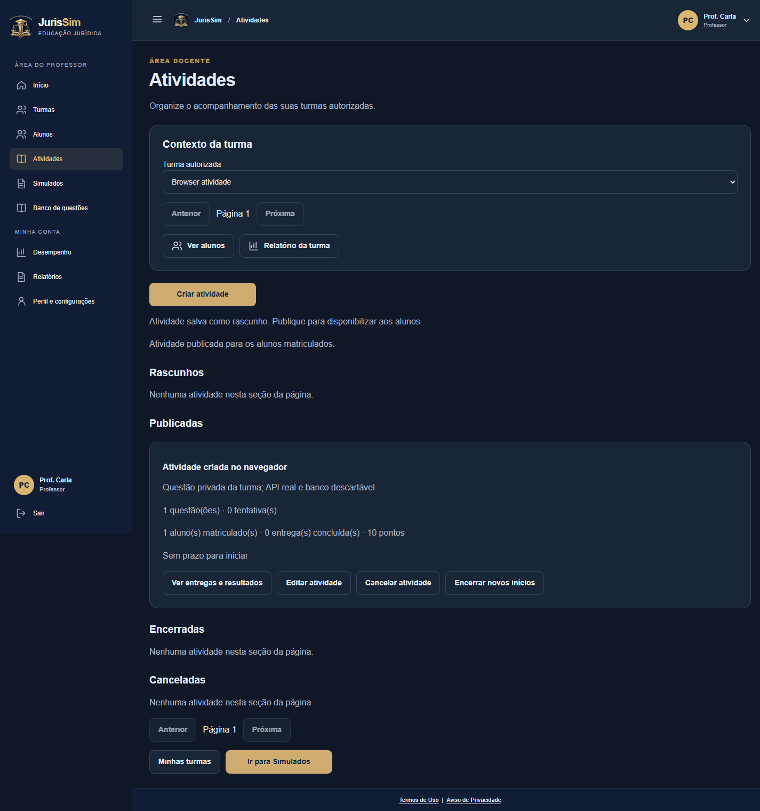
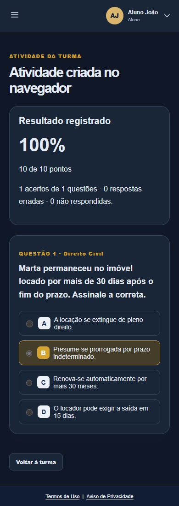
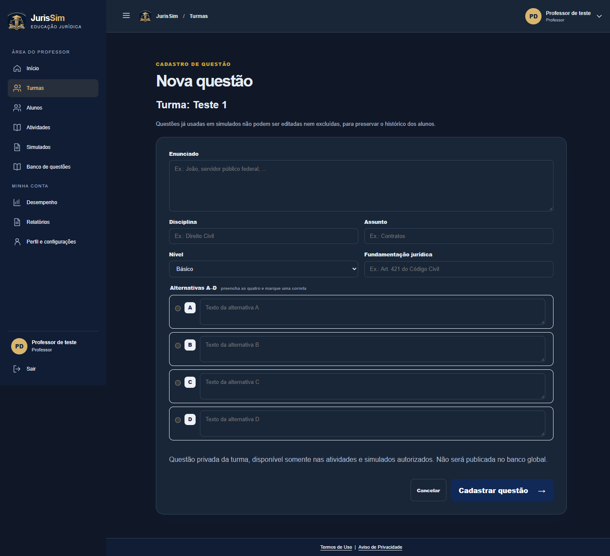
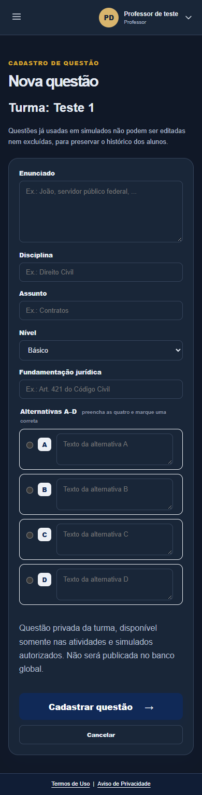
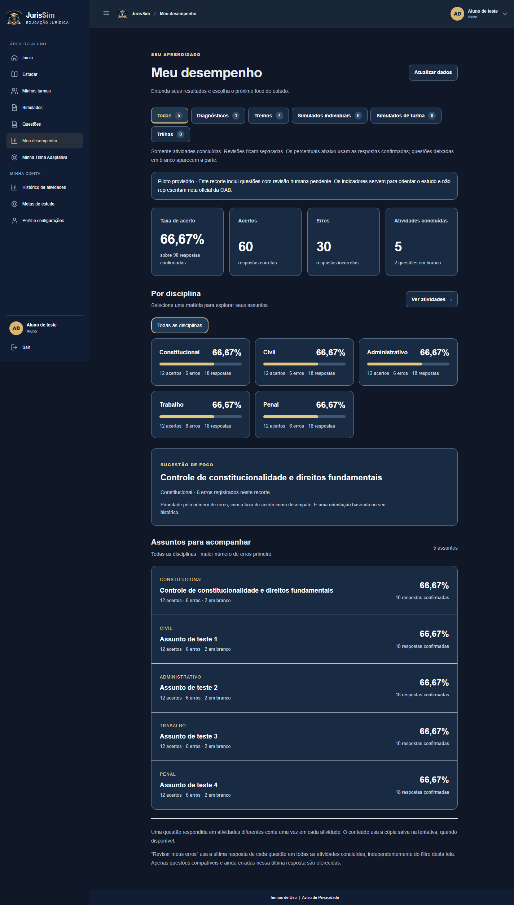

# Evidências de execução — JurisSim

Este índice reúne registros selecionados para a conferência do PFC. Cada evidência possui escopo próprio: uma captura mostra a interface observada, enquanto testes isolados verificam contratos e regras sem comprovar a operação dos serviços publicados.

## Verificações de 16/11/2026

| Evidência | Resultado | Escopo |
| --- | --- | --- |
| [Backend — resumo da execução](verificacoes/backend-isolado-2026-11-16.json) | 1.499 testes aprovados, zero falhas e zero pendentes | Resumo extraído do relatório Vitest da conferência anterior, após incorporar o trabalho da equipe. Inclui data e hash SHA-256 do relatório original; não é uma nova execução. O relatório integral permanece no arquivo local da equipe, sem publicar caminhos e detalhes internos dos casos. |
| [Frontend — saída da execução](verificacoes/frontend-estatico-2026-11-16.txt) | Comando concluído com código 0 | Nova execução de `npm --prefix frontend run test:delivery-static`, com código-base `af729c9d473d98f72e544a0a6ef1b142639e79e8`, branch `entrega-16-11`. Verifica navegação, acessos, contratos e estrutura das telas; não abre navegador nem grava no banco. |
| [Carga — relatório de 14/11](../relatorios/carga-2026-11-14.md) | Seis etapas aprovadas, 5.112 requisições | Execução anterior em banco descartável local, com até 30 alunos concorrentes, vinculada ao commit indicado no relatório. Não comprova essa capacidade no Render/Supabase. |

Para reproduzir os comandos e preparar o ambiente, consulte o [README principal](../../README.md) e o [guia de execução](../execucao-equipe.md).

## Capturas históricas selecionadas

Recuperadas do backup em 16/11/2026 e conferidas visualmente. As imagens abaixo são originais, sem edição, com dados de teste. Não foram geradas novamente nesta etapa: menus, textos e formulários podem diferir da versão atual. Os nomes de professor e aluno presentes nos cenários docentes pertencem às fixtures dos testes.

O [manifesto de arquivos](historico/manifesto.json) registra o caminho original e o hash SHA-256 de cada imagem. Os commits abaixo identificam o versionamento original das capturas, não uma nova execução nem uma certificação da versão atual.

### Atividade publicada pelo professor

Captura versionada no commit `e16eb69f87671bffc8a86df20b460a20b76219ad`, em 15/11/2026. O cenário de origem usa navegador, API autenticada e PostgreSQL descartável, conforme `frontend/tests/test-teacher-live.mjs`.

Mostra uma atividade na seção de publicadas, a turma, a quantidade de questões e os controles de acompanhamento. O layout docente recebeu melhorias posteriores.

### Resultado da atividade no celular

Mesmo cenário e commit da captura anterior. Mostra a tela de resultado com pontuação e alternativa selecionada. A imagem, isoladamente, não comprova o funcionamento atual da publicação ou a correção jurídica do conteúdo de teste.

### Cadastro de questão: computador e celular

Capturas versionadas no commit `e16eb69f87671bffc8a86df20b460a20b76219ad`, em 15/11/2026. O cenário usa respostas simuladas, conforme `frontend/tests/test-question-form.mjs`.

Mostram enunciado, disciplina, assunto, alternativas e seleção de gabarito em duas larguras. Evidenciam a interface e a adaptação visual daquela versão, sem comprovar persistência no banco. O cadastro integrado à atividade foi simplificado depois dessas capturas.

Ver formulário no computador

Ver formulário no celular

### Desempenho do aluno

Captura versionada no commit `6ac2fe9e11341d7f913b586fc279cc55697497c4`, em 15/11/2026. O cenário usa respostas simuladas, conforme `frontend/tests/test-performance-contrast.mjs`.

Mostra filtros, taxa de acerto, distribuição por disciplina e sugestão de foco. Os números são dados do cenário de teste, não resultados de alunos reais. O módulo pode ter recebido alterações posteriores do integrante responsável.

Ver desempenho com dados de teste

## Complementar para a versão final

As evidências históricas acima preservam parte da evolução do projeto. Para comprovar a versão final apresentada, ainda devem ser registradas capturas ou vídeo dos fluxos atuais escolhidos pela equipe:

- Administração: solicitações institucionais, instituições e auditoria.
- Instituição: gestão de professores, convites e turmas.
- Professor: criação integrada de questão e atividade, simulado e acompanhamento dos resultados.
- Aluno: percurso consolidado pelo integrante responsável.
- Integrações habilitadas: confirmação de e-mail, Google e IA, com o resultado efetivamente observado.

Registre ambiente, branch, commit, data, passos, resultado e limitações. Use contas próprias para avaliação e dados fictícios. Não inclua senhas, tokens, URLs privadas, conteúdo de `.env` ou dados pessoais reais. O [checklist de entrega](../entrega.md) reúne as demais conferências.
