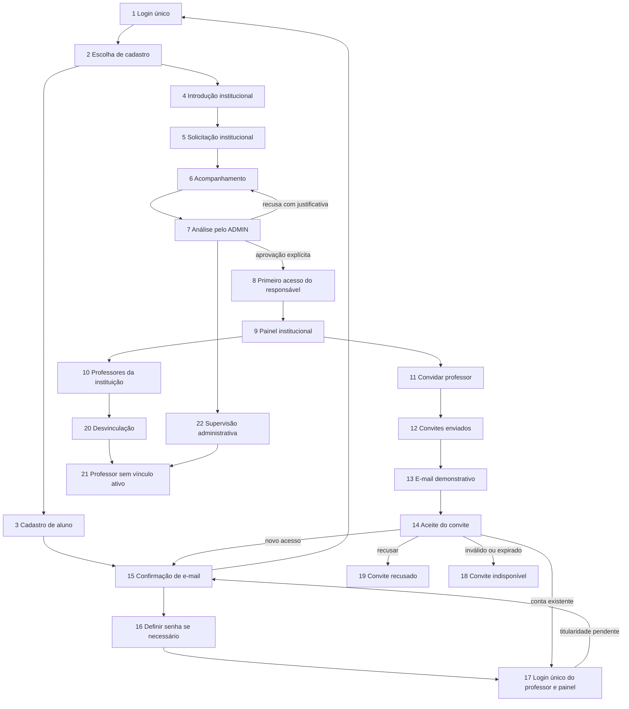

# Fase A — revisão visual do fluxo institucional

## Limite desta entrega

Branch entrega0911. Somente protótipo e auditoria técnica. Nenhuma alteração
funcional de autenticação, API, schema, integração Brevo ou dados foi realizada
nesta fase. As alterações funcionais de etapas anteriores foram preservadas.
Fase B exige aprovação explícita após a revisão desta prévia.

Entrada: http://127.0.0.1:5174/fluxo-institucional

Na raiz do projeto:

```powershell
node .local-admin-preview/start.mjs
```

Se o servidor já estiver ativo, usar o endereço acima. Ele escuta somente em
127.0.0.1:5174. O servidor anterior deve ser encerrado antes de reiniciar para
recarregar CSS. Não iniciar o backend para esta revisão.

O guia lateral de 22 telas e a barra “Ir para tela” são ferramentas da revisão,
não menus de autorização do produto. Usar “Reiniciar demonstração” para começar
outra jornada. É possível inspecionar carregamento, vazio, erro e sem permissão.
Todos os dados são fictícios e ficam em memória. Campos de senha não são
transmitidos, registrados ou persistidos. Usar somente valores fictícios.

## Mapa navegável



A confirmação no protótipo é um botão demonstrativo; não valida e-mail. Contas
existentes seguem sua identidade, sem tela para substituir senha. O professor
novo passa pelo primeiro acesso do convite, não pelo formulário público de aluno.
A simulação de desvinculação retira o acesso institucional da prévia, mantendo
a apresentação de conta/histórico preservados.

## Auditoria do que já existe

| Área | Implementação existente | Lacuna para a proposta |
| --- | --- | --- |
| Login/cadastro | AuthGate, /auth/login, /auth/google, /auth/register e /auth/session; público cria ALUNO | Novo cartão institucional e escolha de cadastro só estão na prévia desta fase |
| Papéis | User.role ALUNO/PROFESSOR/ADMIN; responsável é vínculo INSTITUTION_ADMIN | As quatro categorias de produto não exigem quatro valores em User.role |
| Instituições | Institution com responsável, ownerId, status e justificativa; solicitação sem vínculo prévio | Preservar validações e acompanhamento já implementados |
| Convite | TeacherInvitation: e-mail, hash único, validade, estado, acceptedById; token aleatório de 32 bytes, hash SHA-256, validade de 48 h | Modelo não tem nome convidado nem turmas propostas; não há recusa do destinatário |
| Aceite | POST /institutions/invitations/accept exige usuário autenticado, e-mail confirmado igual ao convidado e instituição ACTIVE | Não há onboarding direto de pessoa sem conta nem inspeção pública controlada do convite |
| Confirmação | AuthToken EMAIL_VERIFICATION, confirmação de uso único e atualização de solicitações | Vincular a prova de e-mail ao novo primeiro acesso, sem substituir confirmação por posse do link do convite |
| Senha | Política compartilhada de oito caracteres, maiúscula, número, especial e limite de bytes | Novo acesso precisa finalidade própria, sem reutilizar reset para tomar conta existente |
| Turmas | InstitutionalClass e relação professores de Turma; autorização usa professor atribuído e contexto institucional | Capturar seleção no convite e validar instituição/turma antes de atribuir após aceite |
| Desvinculação | Desativa TEACHER, desconecta turmas da instituição, incrementa sessionVersion e audita; preserva User.role e histórico | Apresentar explicitamente o estado sem vínculo no frontend |
| Brevo | Transporte API ou SMTP e serviço transacional já existentes | Adaptar template com nome/instituição e integração do novo onboarding; nenhum envio nesta fase |
| Marca/shell | integration-shell.tsx/CSS, styles.css, administration.css e public/brand/jurissim-logo.png | Reutilizar apresentação pura; não importar PhotoProvider, sessão ou apiRequest na prévia |

Os SVGs puros do shell foram extraídos somente dentro da prévia para reutilização
em suas duas entradas. Os módulos reais continuam intocados nesta fase.

### Endpoints que poderão ser reutilizados

- GET /institutions/availability e suas capacidades por operação.
- POST /institutions/requests e GET /institutions/mine.
- GET/PATCH /institutions/admin/institutions[/id], GET /institutions/admin/users,
  GET /institutions/admin/classes e GET /institutions/admin/logs.
- GET /institutions/:id/summary e GET/POST /institutions/:id/invitations.
- POST /institutions/:id/invitations/:invitationId/resend e
  DELETE /institutions/:id/invitations/:invitationId.
- POST /institutions/invitations/accept e DELETE /institutions/:id/teachers/:userId.
- GET /institutions/:id/logs, GET /institutions/notifications e GET /audit-logs.
- Login, sessão, confirmação de e-mail e recuperação existentes em /auth.

### Endpoints adicionais propostos — NÃO implementados

Nomes finais dependem da aprovação técnica da Fase B:

1. POST /institutions/invitations/inspect: token no corpo, resposta mínima com
   instituição, nome apresentado e e-mail mascarado; falhas sem enumeração de contas.
2. POST /institutions/invitations/onboarding: início de primeiro acesso somente
   para convite válido; sem escolher perfil, ownerId ou instituição arbitrária.
3. Conclusão do primeiro acesso: prova de e-mail e definição de senha vinculadas
   ao convite/usuário corretos; emissão da sessão pelo login existente.
4. POST /institutions/invitations/decline: recusa do destinatário com validação
   do convite e prova adequada de titularidade. Cancelamento pelo responsável
   continua distinto da recusa do destinatário.

Não expor token em logs ou query strings de API. Reutilizar captura em fragmento
do link, limpeza da URL e guarda em memória de invitation-token.ts quando apropriado.
Inspeção de convite nunca cria vínculo ou autoriza acesso.

## Proposta de schema — nenhuma migration criada/aplicada

- TeacherInvitation.invitedName opcional, para apresentação e e-mail, sem
  sobrescrever nome da conta existente.
- Relação aditiva TeacherInvitationClass com invitationId/classId se a seleção
  de turmas no convite for aprovada; validar titularidade institucional de cada turma.
- Estado DECLINED pode usar o status String já existente, mas exige validações,
  filtros e testes; não é um cancelamento feito pelo remetente.
- Avaliar finalidade de token de primeiro acesso separada de PASSWORD_RESET.
  AuthToken.type hoje possui apenas EMAIL_VERIFICATION e PASSWORD_RESET; uma
  finalidade adicional ou relação com convite exigirá desenho e migration revisável.
- User, Institution, InstitutionalMembership e históricos não serão duplicados.

Cadastro e senha de pessoa sem conta precisam ser atômicos e resistir à corrida
com criação de conta de mesmo e-mail. Encontrar conta existente exige autenticação
normal, inclusive Google quando aplicável; nunca substituir suas credenciais.

## Matriz proposta de permissões

| Ação | Aluno | Professor | Responsável institucional | ADMIN geral |
| --- | --- | --- | --- | --- |
| Cadastro público individual | Sim, somente ALUNO | Não cria perfil PROFESSOR | Acesso individual sem privilégio prévio | Não há cadastro público ADMIN |
| Solicitar instituição | Com identidade própria | Com identidade própria se pertinente | Sim, sem vínculo anterior | Administração pelo painel autorizado |
| Aprovar/recusar instituição | Não | Não | Não | Sim, com confirmação de e-mail do responsável |
| Convidar/cancelar/reenviar | Não | Não por ser professor | Só na própria instituição ACTIVE e com permissão | Papel global não cria vínculo institucional automaticamente |
| Aceitar convite | Só e-mail destinatário comprovado | Mesma identidade existente | Somente como destinatário legítimo | Caso excepcional deve preservar papel e exigir escopo autorizado |
| Acessar turmas | Apenas matrícula autorizada | Só turmas atribuídas e contexto autorizado | Só instituição autorizada | Conforme autorização global existente |
| Desvincular professor | Não | Não por ser professor | Só instituição autorizada | Supervisão não equivale a vínculo institucional |
| Auditoria | Não global | Não global | Somente registros permitidos da própria instituição | Registros globais autorizados |

Nunca confiar isoladamente em IDs fornecidos pelo frontend. A seleção de tela
do protótipo não implementa nem substitui esta matriz.

## Flags e professores preexistentes

ADMINISTRATION_ENABLED e INSTITUTION_REGISTRATION_ENABLED continuam separados
de INSTITUTIONS_ENABLED. Convites, aceite, desvinculação e operação por instituição
dependem da capacidade operacional e das permissões. Nenhuma flag foi alterada.

Há informação histórica de nove professores sem confirmação/vínculos, não um
levantamento atual. Não foi acessado o Supabase. O diagnóstico preparado continua
somente leitura e verifica e-mail, TEACHER ativo, Institution ACTIVE e compatibilidade
das turmas. Não foi executado contra contas reais nesta Fase A.

O cálculo atual de acesso efetivo pode retornar ALUNO para User.role PROFESSOR
sem vínculo quando o módulo integral está ativo; isso não altera o papel no banco,
mas não apresenta a nova tela explícita de pendência. A Fase B deverá resolver essa
apresentação sem liberar rotas docentes nem converter contas persistidas.

O modelo admite múltiplas instituições por professor, com escolha de contexto.
O serviço de turmas também verifica a atribuição do professor. A seleção de turmas
no convite deverá respeitar ambos os controles, sem autorizar todas as turmas por
um ID recebido. Nenhum suporte adicional foi implementado na Fase A.

## Riscos e decisões que exigem aprovação

1. Aprovar o login/cartão institucional, escolha pública e as 22 telas.
2. Aprovar o onboarding sem cadastro público de professor e a ordem de prova de
   e-mail, definição de senha e ativação do vínculo.
3. Definir a prova exigida para recusar convite e os casos de contas Google existentes.
4. Aprovar nome e turmas no convite e a migration aditiva correspondente, se necessária.
5. Definir o comportamento de professor sem vínculo sem alterar contas antigas.
6. Confirmar o diagnóstico atual dos professores em operação autorizada separada;
   manter IDs, senhas e histórico, sem vínculo fictício ou confirmação manual.
7. Autorizar explicitamente a Fase B. Isso não autoriza automaticamente migration,
   envio real, alteração de conta real ou ativação de flags no ambiente compartilhado.

## Evidências e validação da prévia

`node .local-admin-preview/inspect-institutional-flow.mjs` usa Chrome headless
com perfil separado, interceptação bloqueando destinos externos e sem sessão real.
Navega pelas 22 telas em desktop e celular, verifica fluxos de conta nova/existente,
preservação de senha, estados, desvinculação e ausência de rolagem horizontal.
Capturas e relatório ficam em `.local-admin-preview/.artifacts/` (ignorados pelo Git).

`node .local-admin-preview/verify.mjs` verifica imports puros, isolamento, CSP,
logo oficial e ausência da prévia no build principal. A CSP bloqueia conexões,
formulários externos e frames; HMR não é injetado. Fontes remotas são removidas
da apresentação offline; pode haver diferença tipográfica de fallback.

Essas evidências validam somente navegação e apresentação local. Não comprovam
permissões operacionais, token real, autenticação, Brevo, envio ou persistência.
Não foram iniciadas implementações funcionais da Fase B.
